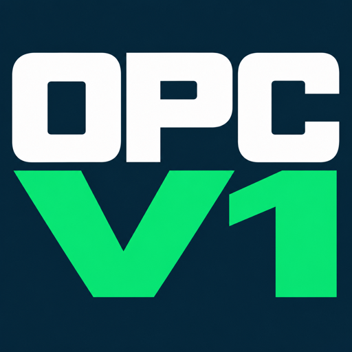
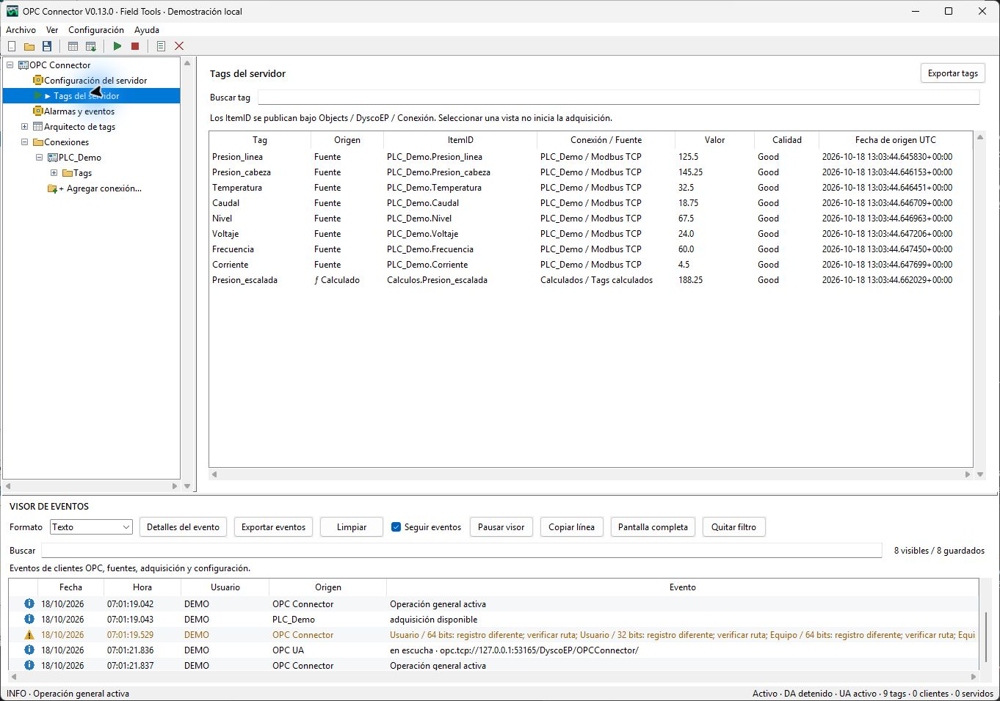
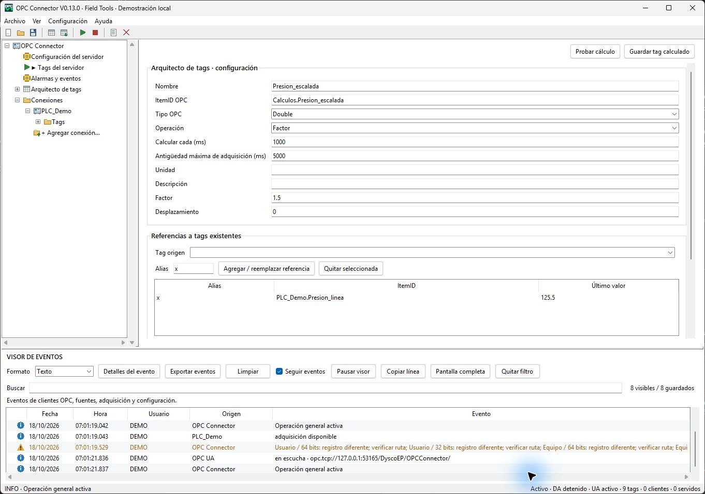

# OPC Connector

**Conecta fuentes industriales y publica tus variables mediante OPC DA y OPC UA.**

OPC Connector es una herramienta de escritorio de **Dysco Exploration and Production**, parte de **Field Tools de cloudLOGGER SCADA**, para adquirir, organizar, transformar y publicar tags desde un mismo entorno.

**V0.13.1 · Windows 10/11 x64 · Portable**

[**Descargar OPC Connector para Windows x64**](https://github.com/DyscoEP/opc-connector/releases/latest/download/OPC-Connector-Windows-x64.zip)

> OPC DA requiere OPC Core Components y .NET Framework 4.8 instalados por separado. La disponibilidad de un driver depende del modelo, firmware, permisos e interfaz del equipo.

[Guía de uso](docs/guia-de-uso.md) · [Prerrequisitos](docs/prerrequisitos.md) · [Drivers y límites](docs/drivers-y-limites.md) · [Limitaciones y problemas](docs/limitaciones-y-problemas.md) · [Soporte](https://github.com/DyscoEP/opc-connector/issues/new/choose)

## Qué puedes hacer

| Función | Características |
|---|---|
| Fuentes | Modbus TCP/RTU, MySQL, SQL Server, JSON/REST, OPC DA local, OPC UA, ICMP, SNMP, Siemens S7 TCP y Allen-Bradley compatibles. |
| Publicación | Catálogo compartido OPC DA 2.05a/3.0 y OPC UA; API REST de salida opcional de solo lectura. |
| Escritura | Permiso por tag, validación de tipo, confirmación de la fuente y relectura en drivers compatibles. SQL, JSON/REST, ICMP, SNMP y tags calculados son de lectura. |
| Tags | Carpetas, búsqueda, edición individual y masiva, importación y creación por lotes según la fuente. |
| Cálculos | Escalamiento, factor/coeficiente y ecuaciones con constantes, funciones y referencias a tags; intervalo propio y validación de dependencias. |
| Túnel | Una conexión OPC UA puede adquirir otro servidor y republicar valores; conserva calidad/fecha y controla ciclos entre conectores. |
| Alarmas | Reglas locales con umbral, estado o calidad y reconocimiento; publicación OPC A&E clásica y OPC UA A&C con alcance limitado. |
| Escritorio | Proyectos, visor de eventos con retención acotada, diario rotativo y controles de iniciar/detener desde la bandeja. |

## Capturas

Conoce el catálogo de variables y las herramientas para transformar tus señales.

## Inicio y requisitos

1. Extrae todo el ZIP y ejecuta `OPC Connector.exe`. No necesitas instalar Python.
2. Crea y guarda una conexión; para SQL carga las tablas del servidor con el botón de recarga.
3. En la carpeta **Tags**, explora/importa o crea los tags según el driver. Revisa dirección, formato nativo, tipo OPC y permiso.
4. Configura los apartados OPC DA, OPC UA y API REST; inicia adquisición y publicación con el control general.
5. Conecta tu cliente al endpoint UA configurado o al ProgID DA `DyscoEP.OPCServer.Connector.1`.

La aplicación debe permanecer abierta. No incluye servicio de Windows, inicio automático como servicio ni certificación Windows Server. Para acceso remoto configura interfaces, certificados y políticas UA apropiadas; el túnel UA evita extender DCOM entre equipos.

[Prerrequisitos completos](docs/prerrequisitos.md) · [Puesta en marcha](docs/puesta-en-marcha.md)

## Novedades de V0.13.1

- Allen-Bradley ControlLogix/CompactLogix, Micro800, SLC/MicroLogix y PLC-5 mediante EtherNet/IP.
- Ruta DH+ mediante gateway compatible; DF1 Full Duplex para SLC/MicroLogix.
- Exploración de símbolos compatibles, importación CSV/L5X y creación por dirección inicial, cantidad, paso y prefijo.
- Iconos nativos para abrir, iniciar, detener y salir en la bandeja.

## Conectividad y compatibilidad

Conecta equipos y aplicaciones mediante los protocolos disponibles y configura cada tag según su dirección, formato y permisos. Siemens S7 TCP permite acceder a memoria compatible; las rutas DH+ requieren un gateway y DF1 utiliza Full Duplex para SLC/MicroLogix.

Consulta la [cobertura por fuente](docs/drivers-y-limites.md) para elegir la conexión apropiada y los [requisitos de instalación](docs/prerrequisitos.md) antes de ponerla en servicio.

## Paquete oficial

[Descarga estable](https://github.com/DyscoEP/opc-connector/releases/latest/download/OPC-Connector-Windows-x64.zip) · [SHA256SUMS](https://github.com/DyscoEP/opc-connector/releases/latest/download/OPC-Connector-SHA256SUMS.txt) · [Releases](https://github.com/DyscoEP/opc-connector/releases/latest) · [Historial](CHANGELOG.md)

Extrae el ZIP completo y conserva todas sus carpetas junto a `OPC Connector.exe`. Incluye las instrucciones de inicio y los avisos de licencia. Las [fuentes de terceros](https://github.com/DyscoEP/opc-connector/releases/latest/download/OPC-Connector-Third-Party-Sources.zip) se entregan por separado; no incluyen fuentes propias de la aplicación. **Code → Download ZIP** descarga este repositorio de documentación, no el programa portable.

## Licencia y soporte

Consulta las condiciones de uso en [LICENSE.txt](LICENSE.txt) y las atribuciones de componentes en [THIRD-PARTY-NOTICES.txt](THIRD-PARTY-NOTICES.txt). OPC Core Components y otros requisitos externos no se redistribuyen en el ZIP. Este repositorio mantiene documentación y soporte; las fuentes propias de la aplicación permanecen privadas. Las obligaciones de componentes de terceros se detallan en los avisos de licencia.

Reporta problemas en [Issues](https://github.com/DyscoEP/opc-connector/issues/new/choose). No publiques credenciales, proyectos sin depurar, certificados privados ni información de instalaciones.

[cloudLOGGER SCADA](https://cloudloggerscada.com) · [NIC Analyzer](https://github.com/DyscoEP/nic-analyzer) · [Modbus Audit](https://github.com/DyscoEP/modbus-audit)
